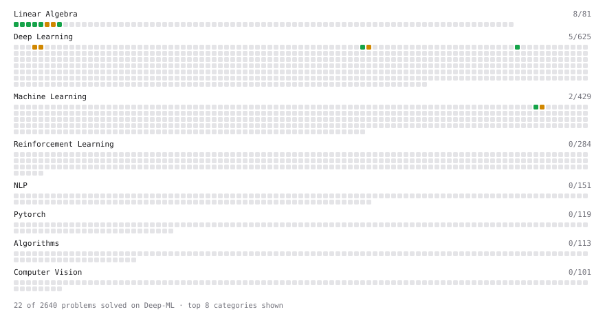

# Deep-ML

My machine learning practice from [Deep-ML](https://www.deep-ml.com). Every solution here was written by hand.

**57** solved · 56 problems · 0 labs · 1 math

[**Browse the interactive portfolio**](https://golevss.github.io/deep-ml/) to replay this filling in over time.

## Problems

| | Difficulty | Solved | |
| --- | --- | --- | --- |
| [Calculate 2x2 Matrix Inverse](https://www.deep-ml.com/problems/8) | easy | 2026-02-08 | [solution](problems/0008-calculate-2x2-matrix-inverse) |
| [Calculate Accuracy Score](https://www.deep-ml.com/problems/36) | easy | 2026-02-16 | [solution](problems/0036-calculate-accuracy-score) |
| [Calculate Cosine Similarity Between Vectors](https://www.deep-ml.com/problems/76) | easy | 2026-02-09 | [solution](problems/0076-calculate-cosine-similarity-between-vectors) |
| [Calculate Covariance Matrix](https://www.deep-ml.com/problems/10) | easy | 2026-02-12 | [solution](problems/0010-calculate-covariance-matrix) |
| [Calculate Image Brightness](https://www.deep-ml.com/problems/70) | easy | 2026-02-11 | [solution](problems/0070-calculate-image-brightness) |
| [Calculate Mean by Row or Column](https://www.deep-ml.com/problems/4) | easy | 2026-02-07 | [solution](problems/0004-calculate-mean-by-row-or-column) |
| [Coefficient of Variation per Group with Small-Sample Correction](https://www.deep-ml.com/problems/2236) | easy | 2026-11-26 | [solution](problems/2236-coefficient-of-variation-per-group-with-small-sample-correction) |
| [Convert Vector to Diagonal Matrix](https://www.deep-ml.com/problems/35) | easy | 2026-02-10 | [solution](problems/0035-convert-vector-to-diagonal-matrix) |
| [Derivative of a Polynomial](https://www.deep-ml.com/problems/116) | easy | 2026-02-03 | [solution](problems/0116-derivative-of-a-polynomial) |
| [Derivatives of Activation Functions](https://www.deep-ml.com/problems/217) | easy | 2026-02-05 | [solution](problems/0217-derivatives-of-activation-functions) |
| [Dot Product Calculator](https://www.deep-ml.com/problems/83) | easy | 2026-02-09 | [solution](problems/0083-dot-product-calculator) |
| [Exponential Weighted Average of Rewards](https://www.deep-ml.com/problems/161) | easy | 2026-02-17 | [solution](problems/0161-exponential-weighted-average-of-rewards) |
| [First Look at a Table: Shape, Types, Missing Values and Unique Counts](https://www.deep-ml.com/problems/2319) | easy | 2026-11-26 | [solution](problems/2319-first-look-at-a-table-shape-types-missing-values-and-unique-counts) |
| [Gradient Direction and Magnitude](https://www.deep-ml.com/problems/308) | easy | 2026-02-04 | [solution](problems/0308-gradient-direction-and-magnitude) |
| [Implement 2D Average Pooling](https://www.deep-ml.com/problems/265) | easy | 2026-02-15 | [solution](problems/0265-implement-2d-average-pooling) |
| [Implement Compressed Column Sparse Matrix Format (CSC)](https://www.deep-ml.com/problems/67) | easy | 2026-02-10 | [solution](problems/0067-implement-compressed-column-sparse-matrix-format-csc) |
| [Implement Compressed Row Sparse Matrix (CSR) Format Conversion](https://www.deep-ml.com/problems/65) | easy | 2026-02-10 | [solution](problems/0065-implement-compressed-row-sparse-matrix-csr-format-conversion) |
| [Implement Gradient Clipping by Value](https://www.deep-ml.com/problems/292) | easy | 2026-02-05 | [solution](problems/0292-implement-gradient-clipping-by-value) |
| [Implement Orthogonal Projection of a Vector onto a Line](https://www.deep-ml.com/problems/66) | easy | 2026-02-10 | [solution](problems/0066-implement-orthogonal-projection-of-a-vector-onto-a-line) |
| [Implement ReLU Activation Function](https://www.deep-ml.com/problems/42) | easy | 2026-02-13 | [solution](problems/0042-implement-relu-activation-function) |
| [Linear Regression Using Gradient Descent](https://www.deep-ml.com/problems/15) | easy | 2026-02-13 | [solution](problems/0015-linear-regression-using-gradient-descent) |
| [Matrix-Vector Dot Product](https://www.deep-ml.com/problems/1) | easy | 2026-02-06 | [solution](problems/0001-matrix-vector-dot-product) |
| [Momentum Optimizer](https://www.deep-ml.com/problems/146) | easy | 2026-02-09 | [solution](problems/0146-momentum-optimizer) |
| [Poisson Distribution Probability Calculator](https://www.deep-ml.com/problems/81) | easy | 2026-02-13 | [solution](problems/0081-poisson-distribution-probability-calculator) |
| [Reshape Matrix](https://www.deep-ml.com/problems/3) | easy | 2026-02-06 | [solution](problems/0003-reshape-matrix) |
| [Scalar Multiplication of a Matrix](https://www.deep-ml.com/problems/5) | easy | 2026-02-07 | [solution](problems/0005-scalar-multiplication-of-a-matrix) |
| [Select Rows and Columns with Boolean Masks](https://www.deep-ml.com/problems/2320) | easy | 2026-11-26 | [solution](problems/2320-select-rows-and-columns-with-boolean-masks) |
| [Taylor Series Approximation](https://www.deep-ml.com/problems/310) | easy | 2026-02-09 | [solution](problems/0310-taylor-series-approximation) |
| [Transformation Matrix from Basis B to C](https://www.deep-ml.com/problems/27) | easy | 2026-02-10 | [solution](problems/0027-transformation-matrix-from-basis-b-to-c) |
| [Transpose of a Matrix](https://www.deep-ml.com/problems/2) | easy | 2026-02-06 | [solution](problems/0002-transpose-of-a-matrix) |
| [2D Translation Matrix Implementation](https://www.deep-ml.com/problems/55) | medium | 2026-02-13 | [solution](problems/0055-2d-translation-matrix-implementation) |
| [Calculate Eigenvalues of a Matrix](https://www.deep-ml.com/problems/6) | medium | 2026-02-07 | [solution](problems/0006-calculate-eigenvalues-of-a-matrix) |
| [Chain Rule for Composite Functions](https://www.deep-ml.com/problems/214) | medium | 2026-02-05 | [solution](problems/0214-chain-rule-for-composite-functions) |
| [Classify Critical Points Using Hessian Eigenvalues](https://www.deep-ml.com/problems/311) | medium | 2026-02-15 | [solution](problems/0311-classify-critical-points-using-hessian-eigenvalues) |
| [Compute the Hessian Matrix](https://www.deep-ml.com/problems/218) | medium | 2026-02-05 | [solution](problems/0218-compute-the-hessian-matrix) |
| [Derivative of Cross-Entropy Loss w.r.t. Logits](https://www.deep-ml.com/problems/220) | medium | 2026-02-05 | [solution](problems/0220-derivative-of-cross-entropy-loss-w-r-t-logits) |
| [Derivative of Softmax](https://www.deep-ml.com/problems/219) | medium | 2026-02-05 | [solution](problems/0219-derivative-of-softmax) |
| [Find Captain Redbeard's Hidden Treasure](https://www.deep-ml.com/problems/127) | medium | 2026-02-14 | [solution](problems/0127-find-captain-redbeard-s-hidden-treasure) |
| [Find the column space of a matrix](https://www.deep-ml.com/problems/68) | medium | 2026-02-10 | [solution](problems/0068-find-the-column-space-of-a-matrix) |
| [Gauss-Seidel Method for Solving Linear Systems](https://www.deep-ml.com/problems/57) | medium | 2026-02-13 | [solution](problems/0057-gauss-seidel-method-for-solving-linear-systems) |
| [Implement Gradient Descent Variants with MSE Loss](https://www.deep-ml.com/problems/47) | medium | 2026-02-14 | [solution](problems/0047-implement-gradient-descent-variants-with-mse-loss) |
| [Implement Reduced Row Echelon Form (RREF) Function](https://www.deep-ml.com/problems/48) | medium | 2026-02-13 | [solution](problems/0048-implement-reduced-row-echelon-form-rref-function) |
| [Implementing Basic Autograd Operations](https://www.deep-ml.com/problems/26) | medium | 2026-02-05 | [solution](problems/0026-implementing-basic-autograd-operations) |
| [Jacobian Matrix Calculation](https://www.deep-ml.com/problems/202) | medium | 2026-02-05 | [solution](problems/0202-jacobian-matrix-calculation) |
| [Matrix times Matrix ](https://www.deep-ml.com/problems/9) | medium | 2026-02-09 | [solution](problems/0009-matrix-times-matrix) |
| [Matrix Transformation ](https://www.deep-ml.com/problems/7) | medium | 2026-02-08 | [solution](problems/0007-matrix-transformation) |
| [Numerical Gradient Checking](https://www.deep-ml.com/problems/313) | medium | 2026-02-09 | [solution](problems/0313-numerical-gradient-checking) |
| [Partial Derivatives of Multivariable Functions](https://www.deep-ml.com/problems/215) | medium | 2026-02-05 | [solution](problems/0215-partial-derivatives-of-multivariable-functions) |
| [Principal Component Analysis (PCA) Implementation](https://www.deep-ml.com/problems/19) | medium | 2026-02-19 | [solution](problems/0019-principal-component-analysis-pca-implementation) |
| [Product Rule for Derivatives](https://www.deep-ml.com/problems/309) | medium | 2026-02-04 | [solution](problems/0309-product-rule-for-derivatives) |
| [Quotient Rule for Derivatives](https://www.deep-ml.com/problems/312) | medium | 2026-02-04 | [solution](problems/0312-quotient-rule-for-derivatives) |
| [Single Neuron with Backpropagation](https://www.deep-ml.com/problems/25) | medium | 2026-02-05 | [solution](problems/0025-single-neuron-with-backpropagation) |
| [Solve Linear Equations using Jacobi Method](https://www.deep-ml.com/problems/11) | medium | 2026-02-13 | [solution](problems/0011-solve-linear-equations-using-jacobi-method) |
| [Determinant of a 4x4 Matrix using Laplace's Expansion (hard)](https://www.deep-ml.com/problems/13) | hard | 2026-02-17 | [solution](problems/0013-determinant-of-a-4x4-matrix-using-laplace-s-expansion-hard) |
| [Singular Value Decomposition (SVD) of 2x2 Matrix](https://www.deep-ml.com/problems/12) | hard | 2026-02-17 | [solution](problems/0012-singular-value-decomposition-svd-of-2x2-matrix) |
| [SVD of a 2x2 Matrix](https://www.deep-ml.com/problems/28) | hard | 2026-02-17 | [solution](problems/0028-svd-of-a-2x2-matrix) |

## Math

| | Difficulty | Solved | |
| --- | --- | --- | --- |
| [Descriptive Statistics](https://www.deep-ml.com/math-problems/18) | easy | 2026-11-26 | [solution](math/0018-descriptive-statistics) |

---

_This file is regenerated by Deep-ML on every push._
